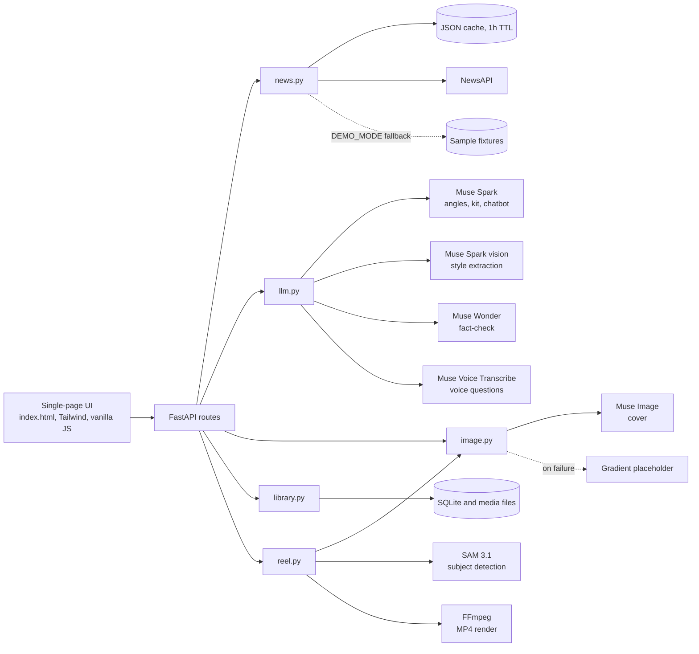

# TrendCraft

Turn today's news into ready-to-post content for creators.

Built for the Meta Global AI Developer Hackathon.

## The problem

Creators who post about the news lose hours every day doing the same three jobs: working out what's worth covering, turning it into hooks, captions and scripts, and checking they haven't got a fact wrong. Generic AI writers don't know today's news, don't sound like the creator, and don't show where their claims came from.

## What it does

1. **Pick a niche.** Finance, Tech/AI, Bollywood, Cricket, Fitness, Food, Travel, Startups, Fashion or any custom topic.
2. **See what's trending.** Muse Spark groups today's stories into 3 to 5 angles, each scored for creator potential (freshness, emotion/virality, explainability) with a one-line reason to post now.
3. **Pick an angle and format.** Reel, carousel, single post or thread.
4. **Get a full post kit.** Three hooks, captions in three tones, a reel script or slides, 10 hashtags, posting tips and a cover image.
5. **Match a style (optional).** Upload 1 to 3 screenshots of posts you like. Muse Spark's vision input extracts tone, layout, colours, caption length and emoji use, and the kit and cover follow them.
6. **Check the facts.** Every kit lists its source articles, and Muse Wonder separately flags any claim the sources don't support.
7. **Make the reel.** A Reel kit becomes a silent vertical MP4 with a new Muse Image scene per beat, SAM-guided camera moves and animated captions. Add your own voice or sound in your editor.
8. **Keep everything.** Each kit is saved to a library with a New, Posted or Archived status, search, and a zip of all its files: cover, reel, scenes, captions (`.srt`), voiceover script and the full copy.
9. **Ask your content.** A chatbot answers from your saved library only, by typing or by voice, and links to the kits it used.

## Architecture



## Meta tech used

| Model | Used for |
| --- | --- |
| Muse Spark (`muse-spark-1.3`) | Clustering stories into scored angles, writing the post kit, answering the chatbot |
| Muse Spark (`muse-spark-1.3`, image input) | Extracting a reusable style from post screenshots |
| Muse Image (`muse-image-1.0`) | Cover images and a scene for each reel beat |
| Muse Wonder (`muse-wonder-1.0`) | Fact-checking, with Muse Spark as a fallback |
| Muse Voice Transcribe (`muse-voice-transcribe-1.0`) | Voice questions in the chatbot |
| SAM 3.1 (`sam-3.1`) | Finding each scene's subject, to aim the camera and keep captions clear of it |

None of the available models generates video or speech, so reels are assembled locally and are silent. The cheaper `-contributor` variants aren't used by default, because content sent to them may be used to train Meta's models.

Model names and endpoints are configured through environment variables. Models are called through an OpenAI-compatible client, and `/api/cover` goes through a single function in `app/services/image.py`, so the image provider can be swapped in one place.

## How the output stays trustworthy

- Source lists come from the fetched articles, not from model output, so links can't be invented. Angles that cite no real article are dropped.
- The kit appears first and the fact-check follows, with a visible "hold off posting" state until it finishes.
- The claim check is a separate model call. If it fails, the UI says the check couldn't run rather than implying the kit is clean.
- The check only sees headlines and summaries from NewsAPI, not full articles, so it's a safety net and not a guarantee.
- Article text is treated as untrusted data in prompts, and rendered output is HTML-escaped.

## Setup

Requires Python 3.10 or newer (3.11 recommended).

Create and activate a virtual environment (Windows):

```bash
python -m venv .venv
```

```bash
.venv\Scripts\activate
```

Install dependencies and create your env file:

```bash
pip install -r requirements.txt
```

```bash
copy .env.example .env
```

Fill in `.env`, then run:

```bash
uvicorn app.main:app --reload
```

Open http://127.0.0.1:8000. `GET /api/health` shows which services are configured, without revealing any values.

## Environment variables

| Variable | Purpose |
| --- | --- |
| `META_API_KEY` | API key for Meta models |
| `META_BASE_URL` | OpenAI-compatible base URL |
| `META_TEXT_MODEL` | Text model name, e.g. `muse-spark-1.3` |
| `META_VISION_MODEL` | Vision-capable model name, e.g. `muse-spark-1.3` |
| `META_FACT_CHECK_MODEL` | Optional fact-check model, e.g. `muse-wonder-1.0`. Falls back to the text model |
| `META_TRANSCRIBE_MODEL` | Optional voice input model, e.g. `muse-voice-transcribe-1.0` |
| `META_SEGMENT_MODEL` | Optional subject detection model, e.g. `sam-3.1` |
| `MUSE_IMAGE_URL` | `https://api.meta.ai/v1/images/generations`. Blank uses placeholders |
| `MUSE_IMAGE_MODEL` | `muse-image-1.0` |
| `NEWS_API_KEY` | NewsAPI key |
| `DEMO_MODE` | `true` falls back to `fixtures/news_{niche}.json` when NewsAPI fails or quota is hit |

Fixtures exist for Finance, Tech/AI and Cricket. They contain invented sample stories, and the UI labels them as sample data whenever they're used.

## API

| Route | Body | Returns |
| --- | --- | --- |
| `GET /api/niches` | | Available niches |
| `POST /api/angles` | `{niche}` or `{custom_query}` | Scored angles with their source articles |
| `POST /api/style` | Multipart `images`, 1 to 3 files, 5 MB each | Extracted style |
| `POST /api/news` | `{niche}` or `{custom_query}` | Headlines only, for the loading screen |
| `POST /api/kit` | `{angle, format, style?, niche?}` | Post kit, saved to the library |
| `POST /api/cover` | `{cover_image_prompt, hook?, palette?, kit_id?}` | Cover image URL or data URI |
| `GET /api/library` | | All saved kits |
| `GET`, `PATCH /api/library/{id}` | `{status}` for `PATCH` | One kit, or set New, Posted or Archived |
| `POST /api/library/{id}/factcheck` | | Runs the claim check |
| `POST /api/library/{id}/reel` | | Starts a reel render; poll the kit for progress |
| `GET /api/library/{id}/bundle` | | Zip of the copy and all files |
| `POST /api/chat` | `{message, history?}` | Answer plus the kits it used |
| `POST /api/chat/transcribe` | Multipart `audio` (WAV) | Transcribed text |

Saved kits and media live in the `data/` folder, which is not committed. This is a single-user app with no login, so don't expose it publicly as it stands.

## Roadmap

- Fetch full article text so the claim check can see more than summaries
- Direct publishing and scheduling to Instagram and Threads
- Saved creator style profiles
- Voiceover recording and carousel slide images
- Accounts, so a library can be private to each creator
- Regional language kits (Hindi, Tamil, Marathi and more)
- Per-claim source citations in the kit
- Learning from which hooks perform best for each creator
"# trendcraft-studio" 
